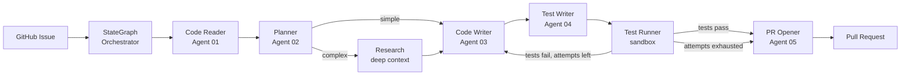

# IssuePilot

**A multi-agent orchestration system that turns a GitHub Issue into a researched, tested pull request — autonomously.**

   

```console
$ issuepilot demo

Issue #103: Intermittent crash rendering profiles when the API returns a null user
Route: complex (score 3) · fix: none_guard
Target: shopcalc/profiles.py :: display_name
Tests: 3 passed, 0 failed (local sandbox, 1 attempt(s))
Status: success
PR: dry-run payload (branch issuepilot/issue-103)
```

Five specialized agents, each owning one task, coordinated by a LangGraph
**StateGraph** orchestrator that routes work on *live state* and conditional
logic — not a fixed chain. A shared `AgentState` carries the whole run:
`{ issue, code_context, plan, patch, tests, pr_url }` plus the bookkeeping a
real system needs (complexity, research notes, attempts, errors).

## The graph



`issuepilot graph` prints this diagram from the compiled graph itself
(LangGraph's own Mermaid export), so the picture can never drift from the code.

## The agents

| Agent | Job |
|---|---|
| **Code Reader** | Scans the repo, ranks files against the issue (explicit path/function mentions, filename and keyword relevance) and builds `code_context`. |
| **Planner** | Scores issue complexity from live signals (body length, files referenced, keywords like *intermittent / multiple / production*, labels) and produces the plan: target file + function, fix pattern, steps. |
| **Research** *(complex route only)* | Widens the context — import-graph neighbours of the target file, other call sites of the target function — before anyone writes code. |
| **Code Writer** | Produces the patch. Demo mode: a library of real AST transformations (percent-rate application, off-by-one range, None guard). LLM mode (`ISSUEPILOT_ENGINE=openai\|anthropic` + key): the model writes the corrected file. Same graph either way. |
| **Test Writer + Runner** | Generates pytest tests for the behaviour the issue described and runs the *whole suite* in a sandbox against a throwaway copy of the repo — the real repo is never touched until the PR opens. |
| **PR Opener** | Assembles the PR (branch, plan, test evidence, diff) and opens it through the GitHub git-data API with `--open-pr`, or emits the dry-run payload by default. |

## Real engineering problems, handled on purpose

- **Conditional routing on live state** — `route_by_complexity` sends simple
  issues straight to the writer and complex ones through Research first;
  `route_by_results` loops failing tests back to the Code Writer.
- **Partial failures** — a bounded fix loop (2 attempts, the retry uses a
  variant transform); a run whose tests still fail ends with a
  `[needs human]` PR payload instead of dying silently.
- **Retries and tool-call errors** — every node runs under the same
  resilience wrapper: transient errors retry with backoff, permanent ones
  are captured into `state.errors` and routed on, never raised through
  the graph.
- **Checkpointing** — the graph compiles with a LangGraph checkpointer, so
  runs are resumable and their state is inspectable by thread id.
- **Sandboxed execution** — tests run on a disposable copy:
  `LocalSandbox` (subprocess + timeout) by default, `DockerSandbox`
  (`python:3.12-slim`, `--network none`, memory cap) with
  `ISSUEPILOT_SANDBOX=docker`. Same result shape; the graph can't tell
  which ran.

## Demo

No API key needed — a sample shop repo with three seeded bugs and three
matching issues:

```console
pip install -e ".[dev]"
issuepilot demo
```

| Issue | Route | Fix |
|---|---|---|
| #101 Tax added flat instead of as a percentage | simple | `amount + rate` → `amount * (1 + rate)` |
| #102 Last in-stock item never counted | simple | `range(len(items) - 1)` → `range(len(items))` |
| #103 Intermittent crash on a null user | **complex → Research** | `if user is None: return "Unknown"` guard |

## Usage

```console
issuepilot run --issue-file issue.json --repo ./my-repo [--out pr.md]
issuepilot run --issue-number 142 --repo-slug owner/name --repo ./clone
issuepilot run --issue-number 142 --repo-slug owner/name --repo ./clone --open-pr
issuepilot graph
```

`--open-pr` (with `GITHUB_TOKEN`) creates the branch, commits the patch and
the generated tests through the git-data API, and opens the pull request for
real. Without it you get the complete payload — title, plan, test evidence,
diff — as a dry run.

## Docker

```console
docker compose up sandbox   # a disposable worker with the repo mounted read-only
docker build -t issuepilot . && docker run --rm issuepilot demo
```

## Development

```console
pytest -q   # routing, reader, transforms, and three end-to-end graph runs
```

## License

zlib License — see [LICENSE](LICENSE). © 2026 Sravanthi Panga.
